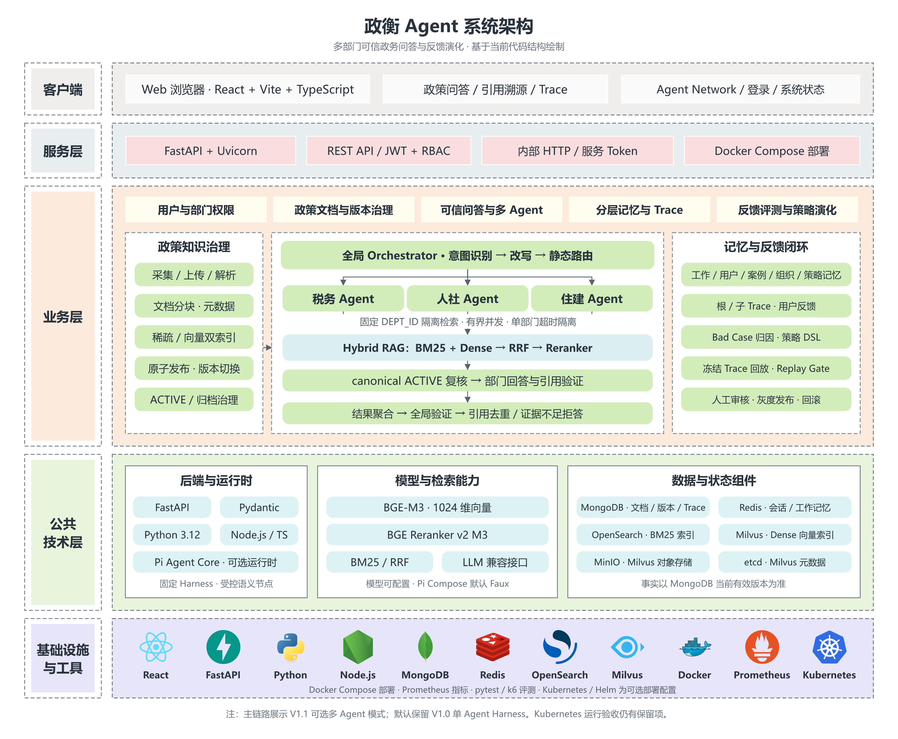
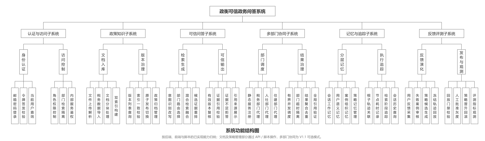

<div align="center">

# 政衡 · ZhengHeng Agent

**面向多部门政策咨询的可信 RAG 与 Agent 工程实践**

让政策回答有出处，让版本变化可追踪，让策略调整可回放。

`Hybrid RAG` · `受控 Agent Harness` · `多部门协同` · `文档版本治理` · `反馈演化`

[系统架构](#系统架构) · [功能全景](#功能全景) · [业务流程](#业务流程) · [快速启动](#快速启动) · [验证与边界](#验证与边界)

</div>

## 项目简介

政衡围绕政策问答中的三个问题构建：**检索到的政策是否仍然有效、跨部门问题如何汇总、回答出错后如何定位与改进**。

系统将文档采集、版本发布、混合检索、带引用回答、执行追踪和策略回放连接成完整流程。V1.1 在单 Agent 基础上增加税务、人社、住建三个隔离的部门 Agent，由全局编排器统一路由、并行调度和验证结果。

模型负责意图识别、改写和回答等语义任务；部门边界、版本有效性、引用检查和策略发布由应用代码控制。工程实现覆盖 **RAG 数据链路、Agent 编排、后端服务治理与可复现评测**。

## 核心设计

| 关注点 | 实现方式 |
| --- | --- |
| **政策更新后，旧内容仍被召回** | MongoDB 保存规范文档与当前版本指针；双索引准备完成后原子发布，检索结果再做 canonical ACTIVE 复核。 |
| **关键词与语义检索各有盲区** | OpenSearch BM25 与 Milvus Dense 并行召回，经 RRF 融合、BGE Reranker 重排后构建证据上下文。 |
| **跨部门问题涉及多个知识范围** | 静态注册部门 Agent，使用不可变 `DEPT_ID` 限定检索范围；有界并发、独立超时，聚合通过本地验证的结果。 |
| **生成结果需要来源依据** | 固定 Harness 串联检索、回答与验证，输出引用卡片；验证未通过时走受控重试或拒答路径。 |
| **问题难以复现和归因** | 保存节点输入输出摘要、检索阶段统计、运行时事件及根 / 子 Trace，关联用户反馈与失败案例。 |
| **策略调整需要可控上线** | 受约束的策略 DSL、冻结 Trace 回放、Replay Gate、人工批准灰度，以及晋升与回滚状态管理。 |

## 系统架构

采用五层结构，将交互入口、服务接口、业务编排、公共能力与基础设施分开。图中主链路展示 **V1.1 可选多 Agent 模式**，默认仍保留 V1.0 单 Agent Harness。



[查看矢量图](docs/architecture/zhengheng-architecture.svg) · [下载可编辑架构图](docs/architecture/zhengheng-architecture.drawio)

### 一次问答如何完成

1. **识别与路由**：识别用户意图、改写查询，经静态注册表确定目标部门。
2. **部门内检索**：各部门使用固定作用域，执行 BM25 + Dense → RRF → Reranker。
3. **证据复核**：回查 MongoDB 当前版本与 ACTIVE 状态，过滤失效证据。
4. **回答与验证**：部门内生成答案、检查声明和引用，保存子 Trace。
5. **聚合与返回**：汇总有效段落、统一引用编号、执行全局验证，返回答案或拒答，并记录根 Trace。

单个部门失败可形成带失败信息的部分响应；全部失败或全局验证失败时拒答。聚合阶段保留已验证段落的事实内容，语义运行时仅可辅助选择展示顺序。

## 功能全景

按六个子系统组织已实现能力：认证与访问、政策知识、可信问答、多部门协同、记忆与追踪、反馈评测。



[查看高清功能图](docs/architecture/zhengheng-functions.png) · [查看矢量图](docs/architecture/zhengheng-functions.svg)

当前 Web 入口包括政策咨询、办理记录、协同部门、系统状态和账户登录。“评测管理”页面尚未接入评测服务；文档治理、策略审核等能力主要通过后端 API / 脚本操作，功能图不代表所有能力均已有完整管理界面。

## 业务流程

业务时序图覆盖四个阶段：**登录认证 → 政策入库与发布 → 多部门可信问答 → 反馈与策略审核**，共 70 条交互。

<details>
<summary><strong>展开完整业务时序图</strong></summary>


</details>

[打开高清时序图](docs/architecture/zhengheng-sequence.png) · [查看矢量图](docs/architecture/zhengheng-sequence.svg) · [下载功能图与时序图的可编辑源文件](docs/architecture/zhengheng-business-diagrams.drawio)

图中的文档与策略管理步骤由 API / 脚本发起；“检索与索引组件”合并表示检索逻辑、模型与索引存储。源码依据和绘制说明见 [架构图说明](docs/architecture/README.md)。

## 技术栈

| 层次 | 技术 | 职责 |
| --- | --- | --- |
| 前端 | React · TypeScript · Vite · Ant Design | 问答交互、引用展示、Trace 与 Agent 网络查看 |
| API 与业务 | Python 3.12 · FastAPI · Pydantic · Uvicorn | REST 接口、鉴权、固定 Harness、业务治理 |
| 语义运行时 | Pi Agent Core · Node.js · OpenAI-compatible 接口 | 可选语义节点执行、结构化输出与受控降级 |
| 检索模型 | BGE-M3 · BGE Reranker v2 M3 | 向量化与候选证据重排 |
| 数据与索引 | MongoDB · Redis · OpenSearch · Milvus | 规范事实、记忆状态、稀疏与向量索引 |
| 部署与观测 | Docker Compose · Prometheus · Helm / Kubernetes | 本地服务编排、指标采集与可选集群部署配置 |
| 验证工具 | pytest · Ruff · mypy · Vitest · k6 | 回归测试、静态检查、前端检查与性能评测 |

MinIO 与 etcd 是 Milvus 的存储和元数据依赖。检索模型与回答模型独立配置，具体 LLM 提供方由环境变量选择。

## 快速启动

### 1. 准备环境

需要 Python **3.12**、uv、Node.js / npm，以及能够运行 Linux 容器的 Docker。Pi Runtime 使用 Node.js **22.19.x**，可由 Docker 构建。

以下命令在项目根目录的 **PowerShell** 中执行：

```powershell
# 已有 .env 时保留原配置
if (-not (Test-Path .env)) { Copy-Item .env.example .env }

uv sync --all-groups
npm --prefix frontend install
```

编辑 `.env`，替换 `APP_SECRET`、`OPENSEARCH_INITIAL_ADMIN_PASSWORD`、`MINIO_ROOT_USER`、`MINIO_ROOT_PASSWORD` 与 `INTERNAL_SERVICE_TOKEN` 的示例值。真实密钥仅保存在本地环境中。

### 2. 启动基础设施并初始化账户

```powershell
docker compose up -d mongo mongo-init redis opensearch etcd minio milvus
docker compose ps -a

# 等待依赖健康、mongo-init 成功退出后执行
uv run python scripts/seed_users.py
```

`mongo-init` 初始化文档事务所需的 MongoDB 副本集。首次索引或检索还需要下载 BGE 模型，请为模型与基础设施预留磁盘、内存和下载时间。

### 3. 启动后端和前端

终端一：

```powershell
uv run uvicorn backend.app.main:app --host 127.0.0.1 --port 8000 --reload
```

终端二：

```powershell
npm --prefix frontend run dev
```

| 入口 | 默认地址 |
| --- | --- |
| Web 页面 | [localhost:5173](http://localhost:5173) |
| API 文档 | [localhost:8000/docs](http://localhost:8000/docs) |
| 就绪检查 | [localhost:8000/api/v1/health/ready](http://localhost:8000/api/v1/health/ready) |

本地演示账户定义在 [seed_users.py](scripts/seed_users.py)，仅用于本地开发。就绪检查会探测真实 MongoDB、Redis、OpenSearch 和 Milvus，依赖不可用时返回未就绪。

初始数据库不含政策知识。通过 API 文档上传 / 导入政策后，依次执行 `reindex` 与 `publish`：

```text
解析入库 PARSED → 索引构建 INDEXING → 校验完成 READY → 显式发布 ACTIVE
```

只有发布为当前有效版本的内容才能成为事实证据。默认 `LLM_MODE=fake` 用于确定性流程演示；真实模型需配置 `LLM_MODE=remote` 及对应的 `LLM_BASE_URL`、`LLM_MODEL`、`LLM_API_KEY`。

### 4. 可选：体验多部门 Agent

在同一套基础设施上启用 V1.1：

```powershell
docker compose --profile multi-agent up -d --build
```

全局编排 API 默认暴露在 `8010`。在启动前端的终端设置 API 地址，并重新启动前端开发服务：

```powershell
$env:VITE_API_BASE_URL = "http://localhost:8010/api/v1"
npm --prefix frontend run dev
```

该配置启动全局编排器、Pi Runtime 以及税务、人社、住建三个部门服务。Compose 默认使用 **Pi Faux** 语义运行方式，验证服务协议、真实检索与编排链路；不代表已经接入外部 LLM。部门示例数据与验收步骤见 [多 Agent 文档](docs/multi-agent.md)。

## 验证与边界

项目分别记录检索、生成、编排和部署的验证结果，避免将某一环节通过等同于整体问答质量达标。

| 范围 | 已记录结果与边界 |
| --- | --- |
| V1.0 基线 | `v1.0.0` 为冻结基线，真实基础设施验收见 [V1.0 报告](docs/validation/v1.0.md)。 |
| V1.1 多 Agent | 2026-10-09 报告记录了真实 Compose、部门隔离、并发聚合、故障隔离与根 / 子 Trace 验证；未声明新的稳定发布版本。 |
| Pi Runtime | 已验证运行时循环、结构化协议与降级；该轮验收未验证外部模型提供方。 |
| Kubernetes | Helm lint / template 已通过；Kind、实际 Pod / HPA 与集群故障验收仍有保留项。 |
| 性能测试 | 已记录 10 / 50 VU 基础设施压测；使用 FakeLLM，不能作为真实在线模型端到端性能。200 VU 未执行。 |

### 公开政策评测

冻结集包含 **100 篇政策文档、167 个分块、40 个用例**。以下数值来自已保存的评测摘要：

| 指标 | 结果 |
| --- | ---: |
| Recall@5 | 0.9667 |
| MRR | 0.9556 |
| Citation Correctness | 0.1250 |
| Knowledge-gap Accuracy | 0.0000 |

检索结果与最终回答质量仍存在明显差距，引用正确性和知识缺口识别需要继续改进。这些结果不代表线上真实 LLM 性能；完整指标、数据版本和评测范围见 [可复现结果摘要](docs/results/README.md)。V1.1 的 12 个多 Agent 集成用例用于验证编排与故障处理，不替代公开政策质量评测。

<details>
<summary><strong>展开本地检查命令</strong></summary>

```powershell
uv run pytest backend/tests/unit -q
uv run ruff check backend scripts
uv run mypy backend/app
npm --prefix frontend run lint
npm --prefix frontend run test -- --run
npm --prefix frontend run build

# 依赖真实基础设施；在 Docker Linux 子进程中执行集成测试
uv run python scripts/run_integration_container.py
```

Linux 集成测试路径用于规避已记录的 Windows 原生 CrossEncoder 加载问题，仍连接真实数据与检索服务。完整结果与待验证项见 [V1.1 验收报告](docs/validation/v1.1.md) 和 [验证保留项](docs/validation/environment-notes.md)。

</details>

## 代码导览

```text
backend/app/
├── api/             REST 接口与请求校验
├── ingestion/       文档解析、分块、索引与生命周期
├── retrieval/       BM25、Dense、RRF、重排
├── harness/         固定问答流程、引用与验证
├── agents/          部门服务、全局编排与结果聚合
├── runtime/         Pi / 兼容接口适配与降级
├── memory/          分层记忆与上下文预算
├── evolution/       反馈归因、策略回放、灰度与回滚
├── storage/         数据与检索存储适配
└── observability/   Trace、指标与日志
frontend/            React 交互界面
services/pi-runtime/ TypeScript 语义运行时
deploy/              Prometheus、Helm 与 Kind 配置
eval/ · evalsets/     多 Agent 用例与冻结评测集
scripts/             初始化、评测与集成验收脚本
docs/architecture/   架构图、功能图、时序图及可编辑源文件
```

## 延伸阅读

- [实现与验收规范](docs/IMPLEMENTATION_SPEC.md)：设计约束、模块职责与验收标准。
- [多 Agent 编排](docs/multi-agent.md)：静态注册、部门隔离、故障处理与真实 Compose 验证。
- [Pi Runtime](docs/pi-runtime.md)：运行时协议、允许的语义节点与降级边界。
- [Kubernetes / Helm](docs/kubernetes.md)：最小部署配置与尚未完成的运行验收。
- [更新记录](CHANGELOG.md)：版本演进与实现变化。
